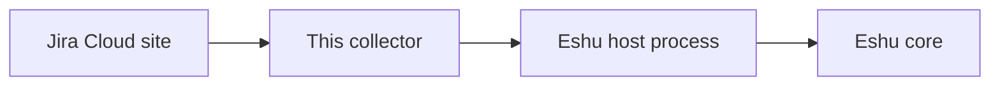
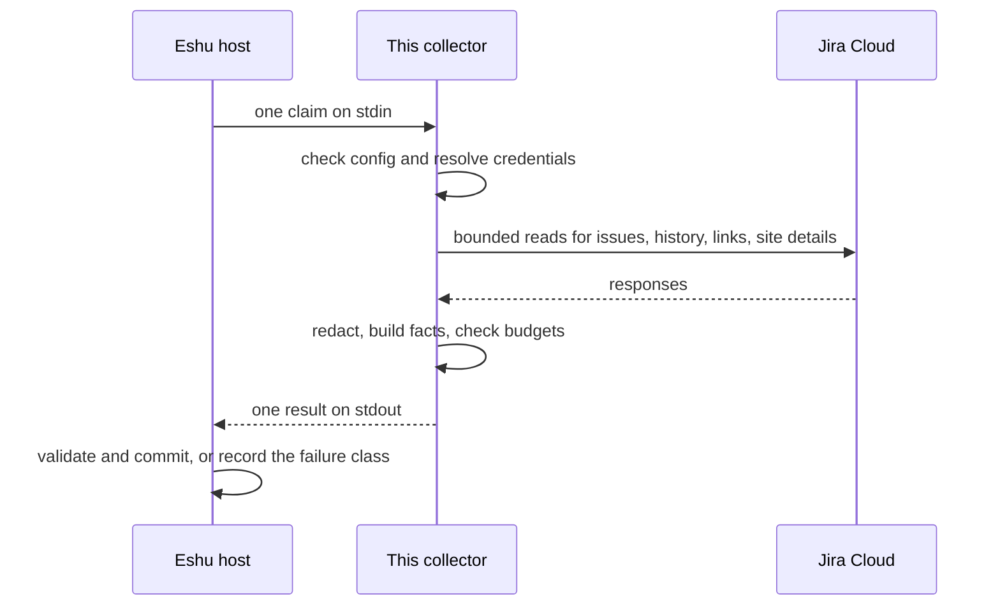

# Diagrams

Every diagram for this collector lives on this page, so there's one
place to keep them honest. Other pages link here instead of copying
the picture.

## System context

How a source system, this collector, the Eshu host, and Eshu core
fit together. The collector only talks to its source and to the
host over stdin/stdout.

Text version: Jira Cloud site, then this collector, then the Eshu host
process (checks and stores the result), then Eshu core. The collector
never talks to Eshu's database directly.

## Claim lifecycle

What happens to one claim, from the host sending it on stdin to the
host committing the result or recording a failure class. The
collector checks config and credentials before any provider call.

Text version: the host sends one claim, the collector checks its config
and credentials, reads Jira within its limits, redacts and builds
facts, and returns one result. The host then validates and commits it,
or records why it failed.
